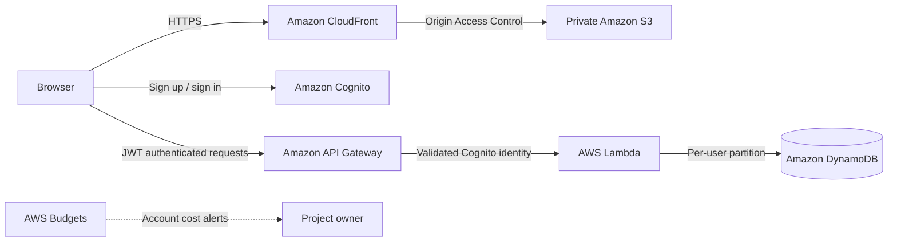

# Student Budget Planner

A full-stack student budgeting application built with React and a serverless AWS backend.

**Live application:** [https://d3051uxkdikknp.cloudfront.net](https://d3051uxkdikknp.cloudfront.net)

This is a team project. My main responsibility was the React frontend. I later modified and extended the backend foundation created by a teammate, integrated the application with AWS, and completed the cloud deployment and frontend-backend debugging. The current version includes Cognito authentication, an authenticated API, per-user DynamoDB storage, infrastructure as code, and secure AWS hosting.

## Architecture



CloudFront serves the React build from a private S3 bucket. Cognito verifies email addresses and issues the ID token used by the browser. API Gateway validates that token before Lambda runs. Lambda derives the DynamoDB partition key from the authenticated Cognito `sub`, so the browser cannot request another user's partition directly.

## Features

- Email registration, verification, login, session restoration, and logout
- Dashboard showing total budget, spending, and remaining balance
- Create, edit, and delete expenses with input validation
- Custom spending categories and category budget limits
- Per-user cloud persistence across devices and browser sessions
- Spending charts, activity notifications, filtering, and PDF report export
- Responsive layouts for desktop and mobile screens
- Friendly authentication errors, verification-code resend, and duplicate-submit protection

## AWS services

| Service | Purpose |
| --- | --- |
| Amazon CloudFront | Public HTTPS delivery and React route rewriting |
| Amazon S3 | Private storage for the production frontend build |
| Amazon Cognito | User accounts, email verification, and JWT sessions |
| Amazon API Gateway | CORS-controlled authenticated HTTP API |
| AWS Lambda | Expense, category, and setting business logic |
| Amazon DynamoDB | Per-user budget data using `USER#<cognito-sub>` partitions |
| AWS CloudFormation / SAM | Reproducible infrastructure and deployments |
| AWS Budgets | Monthly account cost monitoring and email alerts |

## Security and data handling

- Passwords are handled by Cognito and are never stored in this application or DynamoDB.
- API Gateway rejects requests without a valid Cognito JWT.
- Lambda obtains the owner identifier from verified token claims.
- Monetary values are validated and stored as integer cents to avoid floating-point persistence errors.
- The S3 bucket blocks public access; CloudFront reads it through Origin Access Control.
- Production and local browser origins are explicitly listed in the API CORS configuration.

## Local development

Requirements: Node.js 20 or later and npm.

```powershell
cd frontend
npm install
npm run dev
```

Create `.env.development` from `.env.example` and provide the deployed AWS region, Cognito user pool, app client, and API URL. Then open the Vite URL printed in the terminal.

## Repository structure

```text
student-budget-planner/
├── frontend/          React, Vite, frontend tests and static assets
├── backend/           Lambda code, backend tests and AWS SAM template
├── docs/              Portfolio and CV wording
└── README.md          Project overview and architecture
```

## Validation

```powershell
npm --prefix frontend test
npm --prefix frontend run build
node --test backend/tests/domain.test.mjs
sam validate --lint --template-file backend/template.yaml
```

The current test suite contains 11 frontend regression tests and 5 backend domain tests. They cover input validation, state migration, account separation, alerts, date handling, statistics, storage failure handling, and backend domain rules.

## Deployment

AWS resources are declared in [`backend/template.yaml`](backend/template.yaml). Backend deployment instructions and frontend upload steps are documented in [`backend/README.md`](backend/README.md).

The deployed development stack is `student-budget-planner-dev` in `eu-west-1`. CloudFormation outputs the generated API URL, Cognito IDs, S3 bucket name, CloudFront distribution ID, and website URL.

## Current scope

Budget and transaction notifications are generated inside the application. Monthly summary email and daily reminder controls currently store preferences only; scheduled email delivery is outside the implemented scope.
